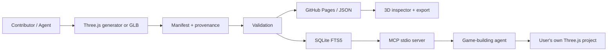

# 3D Worlds — Architecture and Scale Plan

## 1. System boundaries

| Component | Responsibility | Runtime |
|---|---|---|
| `catalog/models.json` | Versioned asset metadata, reviewed provenance and IDs | Git repository |
| `src/models/*.js` | Procedural Three.js generators | Browser / source consumer |
| `src/main.js`, `src/scene.js` | Browse/search, inspect, OrbitControls, GLB export | GitHub Pages |
| `scripts/catalog.py` | Validate registry, build normalized query index | Local / CI |
| `db/schema.sql` | Relational data model + FTS5 | SQLite |
| `services/mcp_server.py` | Search/get/source/import MCP tools | Local process over stdio |
| `scripts/new_model.py` | Create and register a new parametric model | Local CLI |

**GitHub Pages is static.** It cannot host a Python MCP process or provide an
authenticated live SQLite API. The web app imports versioned catalog JSON at build
time; the local MCP server opens the generated SQLite file read-only. A future
remote offering would require separate hosted API and authenticated MCP service.

## 2. IDs and versioning

- Immutable IDs such as `furniture.table.oak-study-001` prevent ambiguous game references.
- `slug` drives SEO/deep links and exported filenames, not primary keys.
- Stable IDs are never recycled. Deprecate old assets instead of silently replacing their geometry.
- `version` is content revision; future ingest should calculate SHA-256 on binaries.
- Human-readable title, localized title, category, tags, descriptions, dimensions, style and license are distinct fields.

## 3. Normalized SQLite schema

`assets` holds the canonical identifier, unit/axis/dimensions, format, status,
license, source, version and optional geometry metrics. `categories` is
hierarchical with `parent_id`. `tags` and `asset_tags` are N:M.
`asset_files` records variants including source/GLB/LOD/thumbnail/texture.
`asset_provenance` records attribution and evidence; `asset_relations` supports
derived_from/variant/part_of/compatible_with.

`assets_fts` is an external-content FTS5 virtual table. INSERT/UPDATE/DELETE
triggers keep the index synchronized; a regression test explicitly verifies
updates and deletion. SQLite's default `unicode61` tokenizer does **not**
provide full Chinese word segmentation. A production Chinese search service
should add segmentation (e.g. jieba) on ingestion or use a dedicated index.
SQL queries are parameterized; limits and offsets are bounded.

## 4. Query and delivery at 50,000 models

The site must **not** import 50,000 procedural JavaScript modules or open 50,000
WebGL canvases. The starter uses fifteen authored procedural generators and
lazily paints visible thumbnails. For scale:

1. Accept source, `.glb`, image previews, SPDX license and provenance.
2. Validate hierarchy, bounding box, coordinates, content hash, triangles,
   textures, security, attribution and duplicate candidates.
3. Generate multiple LODs, compressed GLBs, responsive WebP/AVIF preview cards.
4. Place immutable `sha256/...` model binaries on object storage/CDN,
   separate from Git; retain a content-addressed URL in `asset_files`.
5. Publish sharded JSON facets/pages or a search API for the browser. Avoid
   bundling the entire catalog and avoid one JS module per binary asset.
6. Store the index in SQLite with FTS5 and indexes. Use cursor/keyset
   pagination for deep scrolling or API queries; `OFFSET` is bounded in MVP.
7. Keep read-only MCP search local initially; remote authenticated search
   and signed asset downloads can be a separate service later.

### Back-of-envelope sizing (estimates, not benchmarks)

For 50,000 assets at 2KB average metadata, raw JSON is about 100MB before
compression; therefore a single embedded manifest is unacceptable at scale.
At 5MB average GLB, 50,000 binaries would occupy about 250GB before variants.
The correct split is metadata index vs object storage vs small static site.

## 5. Security, licensing and reliability

- Never execute downloaded arbitrary JavaScript or trust GLTF extensions blindly.
- Keep untrusted imports in isolated validation jobs with resource limits.
- Check path traversal and symlinks before reading any source (MCP tool does).
- Publish only assets with validated license and provenance.
- All exports preserve meter/Y-up convention and carry license info in catalog.
- Use generated thumbnails rather than rendering every card live at scale.
- Avoid exposing arbitrary local filesystem access through MCP; tools return
  content, not write operations into game repositories.
- Browser Clipboard requires secure context and user gesture.
- Validate `glTF` with Khronos glTF Validator as a planned ingest step.
- For future remote MCP: OAuth/service identity, rate limiting, audit logs,
  signed downloads and quota policy; **not implemented in v0.1**.

## 6. Expansion milestones

**V0.1 implemented:** Five initial generators, gallery, inspect/copy/GLB export,
versioned JSON, schema, SQLite builder, local read-only MCP v2 tools, tests.

**V0.2 implemented:** Fifteen procedural assets, dynamic seven-category taxonomy,
batch GLB validation/ingestion, SHA-256 content paths, SQLite quality metrics,
GLTFLoader-backed binary detail view and captured preview thumbnails. Binary
previews require user-supplied images; automatic thumbnail generation and
pagination are not yet implemented.

**V0.3 planned:** Prebuilt image thumbnail workflow, metadata editor,
large-catalog pagination, storage adapters and stronger human review controls.

**V0.4 planned:** Object storage, image search/embeddings, CDN, stronger
licensing workflow, remote MCP, per-asset metrics and preview automation.

**V1.0 planned:** Automated review queue, version API, game-engine
connectors (Unity/Unreal/Godot), semantic search and usage analytics.
